# Ausadhi — Healthcare Appointment Platform

Ausadhi is a full-stack healthcare appointment platform that I designed, built, and deployed independently. It connects patient-facing booking workflows with operational tools for doctors and administrators across three independently deployed applications.

The platform supports doctor discovery, appointment booking, online payments, WhatsApp-based booking, AI-assisted symptom triage, automated appointment reminders, and role-specific doctor/admin workflows.

Live at - ausadhi.in


## Table of Contents

- [Live Demo](#live-demo)
- [Screenshots](#screenshots)
- [Repositories](#repositories)
- [System Overview](#system-overview)
- [Key Features](#key-features)
- [Architecture & Engineering Decisions](#architecture--engineering-decisions)
- [Authentication & Security](#authentication--security)
- [Tech Stack](#tech-stack)
- [Data Model](#data-model)
- [Deployment](#deployment)
- [CI/CD](#cicd)
- [Engineering Highlights](#engineering-highlights)
- [Repository Structure](#repository-structure)

## Live Demo

- [ausadhi.in](https://ausadhi.in)

## Screenshots

<details>
<summary>Patient Views</summary>

### Patient

| Homepage | Doctor Directory | About Us |
|---|---|---|
| 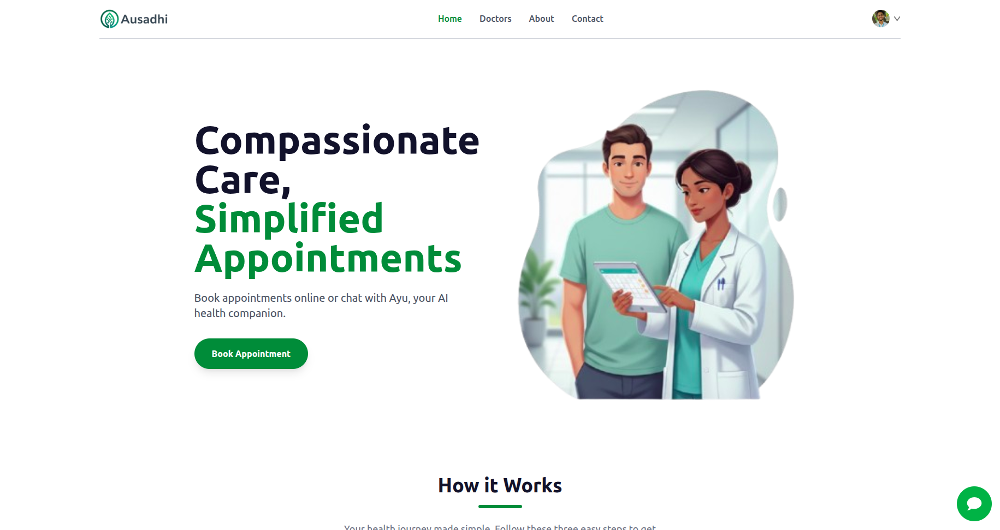 | 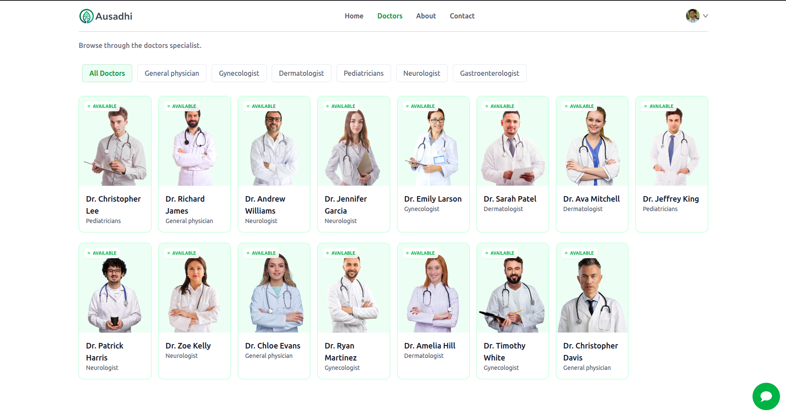 | 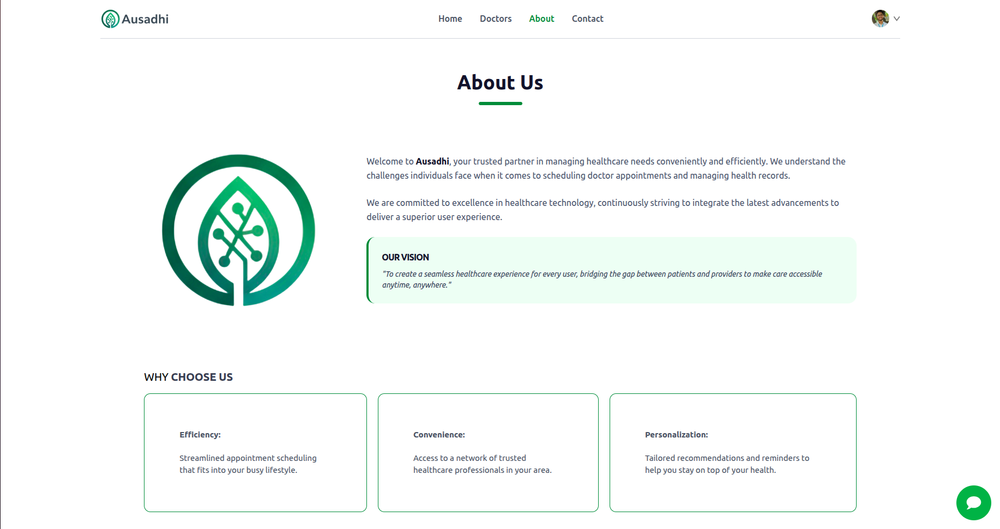 |

| My Appointments | Profile | Ayu AI |
|---|---|---|
| 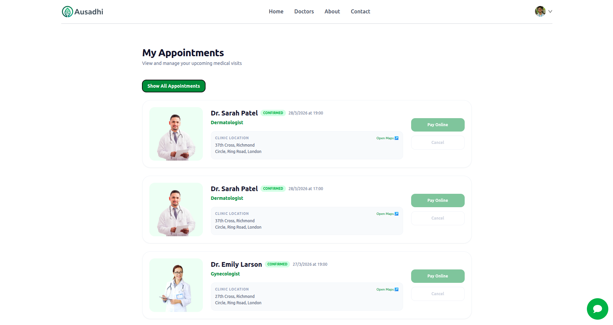 | 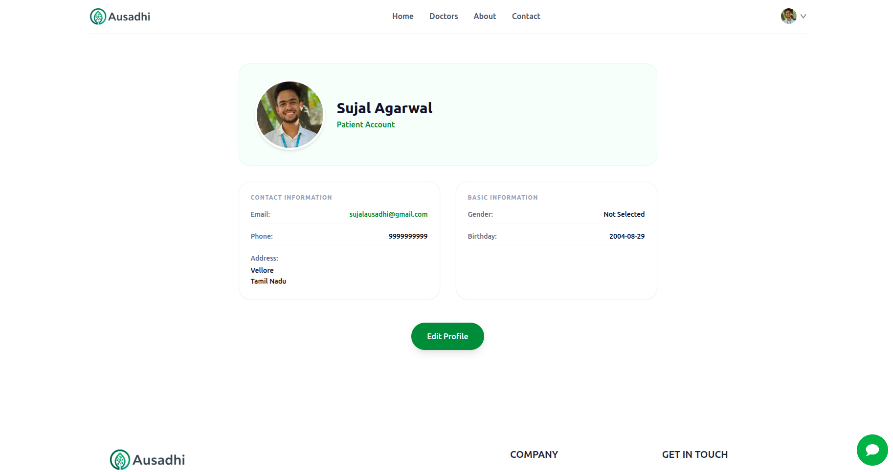 | 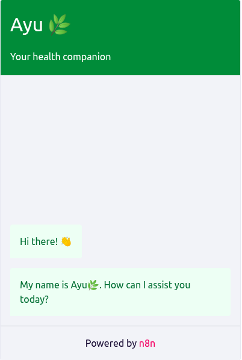 |

</details>

<details>
<summary>Admin Views</summary>

### Admin

| Admin Dashboard | Add Doctor | All Appointments |
|---|---|---|
| 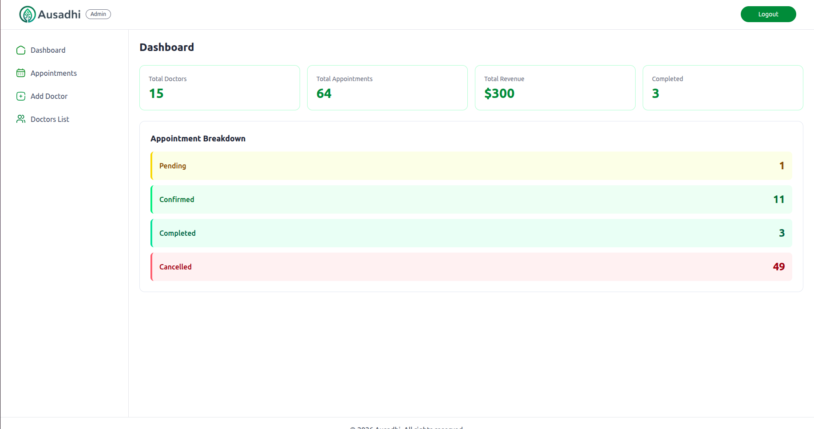 | 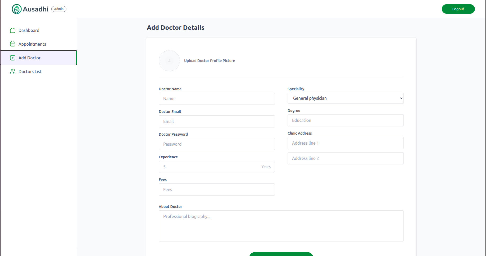 | 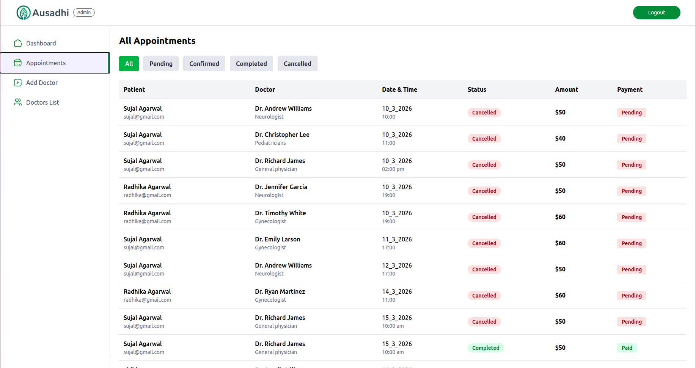 |

</details>

<details>
<summary>Doctor Views</summary>

### Doctor

| Doctor Dashboard | Doctor Profile |
|---|---|
| 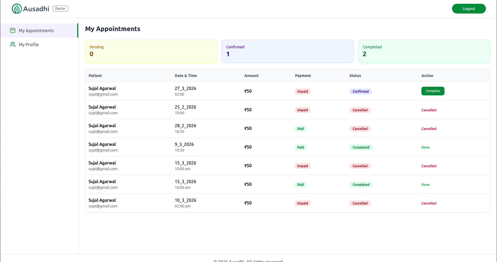 | 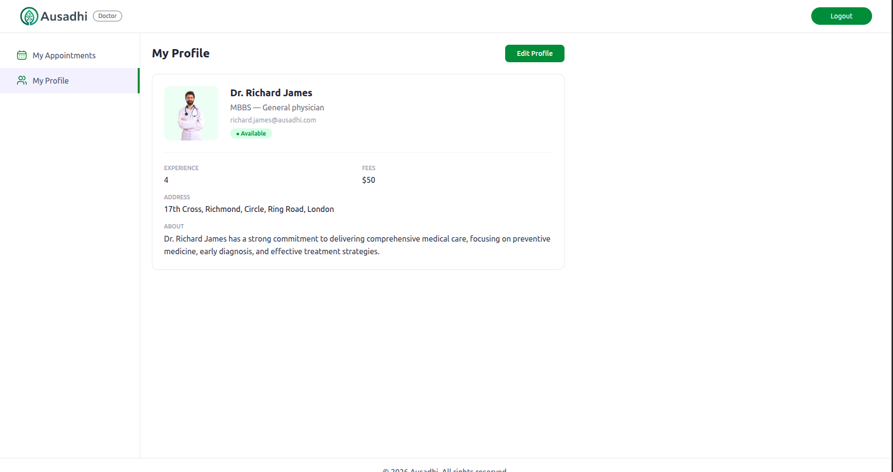 |

</details>


## Repositories

| Application | Repository |
|---|---|
| Patient Frontend | [Ausadhi-frontend](https://github.com/sujal-ag/Ausadhi-frontend) |
| Backend API | [Ausadhi-backend](https://github.com/sujal-ag/Ausadhi-backend) |
| Admin + Doctor Console | [Ausadhi-admin](https://github.com/sujal-ag/Ausadhi-admin) |

Each application is maintained and deployed independently.

---

## System Overview

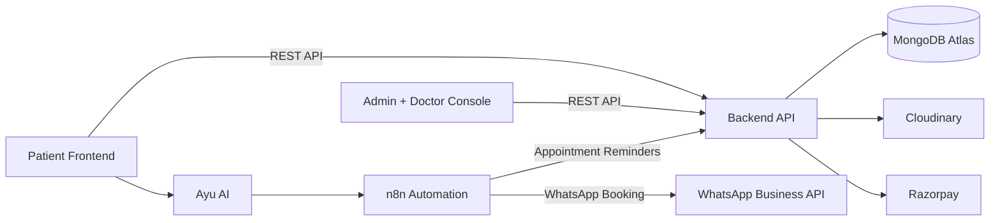

### Applications

- **Patient Frontend** — patient-facing application for doctor discovery, appointments, profiles, payments, and AI-assisted interactions.
- **Backend API** — centralized REST API handling authentication, business logic, appointments, payments, uploads, and persistence.
- **Admin + Doctor Console** — operational application for doctor management, appointment oversight, and doctor workflows.

### Automation

- **n8n** acts as the automation layer for WhatsApp booking and appointment reminder workflows.
- Appointment reminders are automatically triggered **24 hours and 1 hour before the scheduled appointment**.
- WhatsApp is used as an additional appointment-booking channel.

---

## Key Features

### Patient

- Doctor discovery and speciality filtering
- User registration and authentication
- Profile management with image upload
- Appointment booking and cancellation
- Online payment flow
- WhatsApp-based appointment booking
- Ayu AI symptom triage/chat

### Doctor

- Doctor authentication
- Doctor profile management
- Appointment listing
- Appointment status management
- Appointment completion

### Admin

- Admin authentication
- Doctor onboarding
- Doctor profile editing
- Doctor list management
- Appointment oversight
- Dashboard metrics including doctors, appointments, revenue, and status breakdown

### Automation

- WhatsApp-based appointment booking
- Automated appointment reminders
- **24-hour and 1-hour pre-appointment reminders**
- n8n workflow orchestration
- AI-assisted symptom collection and triage

---

## Architecture & Engineering Decisions

### Independently Deployed Applications

The patient-facing application and the admin/doctor console are maintained as separate applications.

This keeps patient UX and operational workflows independently deployable while allowing both applications to share the same backend API.

### Centralized Backend

The backend is deployed independently and acts as the shared service layer for both frontends.

The backend handles:

- Authentication and authorization
- Doctor and patient workflows
- Appointment management
- Payment processing
- Image uploads
- Database operations
- External-service integrations

### Containerized Deployment

The applications are containerized with Docker to provide reproducible deployment environments.

Nginx serves the frontend applications and handles reverse-proxy/HTTPS configuration.

### Infrastructure

The applications are self-hosted on Azure VM infrastructure with:

- Docker
- Nginx
- HTTPS/SSL
- Custom domain and DNS configuration
- MongoDB Atlas for managed database persistence

### Automation Layer

n8n is used as the automation layer for asynchronous workflows that do not need to be handled directly inside the request/response lifecycle.

Current workflows include:

- WhatsApp appointment booking
- Appointment reminder scheduling
- **24-hour pre-appointment reminders**
- **1-hour pre-appointment reminders**
- AI-assisted patient interactions

This separates time-based and automation-heavy workflows from the core backend API and keeps them independently configurable.

These architectural choices were made to gain hands-on experience with application deployment, networking, authentication, infrastructure, and operational workflows.

---

## Authentication & Security

Ausadhi uses JWT-based authentication with HTTP-only cookies.

The authentication system includes:

- Short-lived access tokens
- Long-lived refresh tokens
- HTTP-only cookies
- Refresh-token rotation
- Database-backed refresh-token validation
- Role-based authorization for patients, doctors, and admins
- Axios request/response interceptors
- Proactive and reactive access-token refresh
- Concurrent request handling during token refresh

The frontend also maintains non-sensitive authentication state in local storage for UI purposes. Authentication authority remains server-side.

Detailed implementation is documented in the individual frontend and backend repositories.

---

## Tech Stack

| Layer | Technologies |
|---|---|
| Patient Frontend | React, Vite, React Router, Tailwind CSS, Axios |
| Admin + Doctor Console | React, Vite, React Router, Tailwind CSS, Axios |
| Backend | Node.js, Express, Mongoose |
| Database | MongoDB Atlas |
| Authentication | JWT, HTTP-only cookies |
| Payments | Razorpay |
| Image Storage | Cloudinary |
| Automation | n8n |
| Messaging | WhatsApp Business API |
| Email | Resend |
| Infrastructure | Docker, Docker Compose, Nginx, Azure VM |
| CI/CD | GitHub Actions |

---

## Data Model

The core backend data model revolves around users, doctors, appointments, and payments.

```text
User
 │
 ├───────────────┐
 │               │
 ▼               ▼
Appointment    Payment
 ▲
 │
Doctor
```

**User**
- `name`
- `email`
- `password` (hashed)
- `role` (patient / doctor / admin)
- `profileImage`
- `createdAt`

**Doctor**
- `name`
- `speciality`
- `email`
- `password` (hashed)
- `profileImage`
- `fees`
- `availability`
- `createdAt`

**Appointment**
- `userId` (ref: User)
- `doctorId` (ref: Doctor)
- `date`
- `time`
- `status` (pending / confirmed / cancelled / completed)
- `bookingChannel` (web / WhatsApp)
- `createdAt`
- `updatedAt`

**Payment**
- `appointmentId` (ref: Appointment)
- `amount`
- `razorpayOrderId`
- `razorpayPaymentId`
- `status` (pending / verified / failed)
- `createdAt`

Relationships:
- A **User** can have multiple appointments.
- A **Doctor** can handle multiple appointments.
- An **Appointment** references both the corresponding user and doctor.
- An **Appointment** can have an associated payment record.
- Payment records maintain transaction and verification state separately from the appointment lifecycle.

See the detailed schema in the [Backend repository](https://github.com/sujal-ag/Ausadhi-backend).

---

## Deployment

The three applications are independently containerized and deployed.

| Application | Deployment |
|---|---|
| Patient Frontend | Docker + Nginx |
| Admin + Doctor Console | Docker + Nginx |
| Backend API | Docker |
| Database | MongoDB Atlas |
| Infrastructure | Azure VM |
| HTTPS | Nginx + SSL |
| Automation | n8n |

---

## CI/CD

Deployment is automated using **GitHub Actions**.

On push to the deployment branch, a GitHub Actions workflow:

1. SSHes into the Azure VM
2. Pulls the latest code for the relevant repository
3. Re-runs `docker compose` to rebuild and restart the affected containers

This keeps the three independently deployed applications (Patient Frontend, Backend API, Admin + Doctor Console) each on their own automated deploy path, without manual intervention on the VM.

---

### Patient Application

- Home / doctor discovery
- Speciality filtering
- Doctor profile
- Appointment booking
- Payment flow
- Patient profile
- Ayu AI chat

### Admin Console

- Admin dashboard
- Doctor onboarding
- Doctor management
- Appointment management

### Doctor Console

- Doctor dashboard
- Doctor profile
- Appointment management

---

## Engineering Highlights

- JWT authentication with HTTP-only cookies
- Refresh-token rotation with database validation
- Axios interceptor-based silent token refresh
- Promise-based queue for concurrent `401` requests
- `_retry` protection against refresh loops
- Role-based authorization for patient, doctor, and admin workflows
- Razorpay payment verification
- Cloudinary image upload pipeline
- Separate patient and operational frontend applications
- Dockerized deployments
- Nginx reverse proxy and SSL configuration
- Azure VM deployment
- GitHub Actions CI/CD with SSH-based deploy and Docker Compose rebuild
- n8n-based automation workflows
- **Automated 24-hour and 1-hour appointment reminders**
- WhatsApp appointment booking
- AI-assisted symptom triage

---

## Repository Structure

Ausadhi is maintained across three independent repositories:

```text
Ausadhi
│
├── Patient Frontend
│   └── React + Vite
│
├── Backend API
│   └── Node.js + Express + MongoDB
│
└── Admin + Doctor Console
    └── React + Vite
```

See the individual repositories for implementation details, setup instructions, API documentation, environment configuration, and deployment instructions.

## Repositories

- [Patient Frontend](https://github.com/sujal-ag/Ausadhi-frontend)
- [Backend API](https://github.com/sujal-ag/Ausadhi-backend)
- [Admin + Doctor Console](https://github.com/sujal-ag/Ausadhi-admin)
